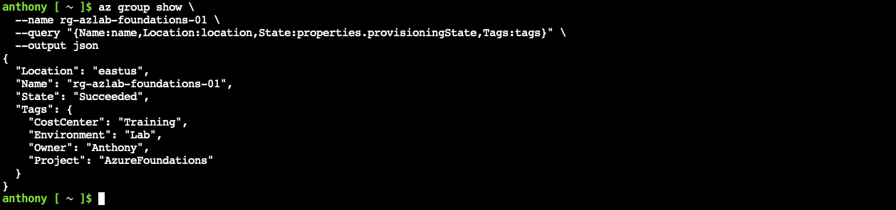
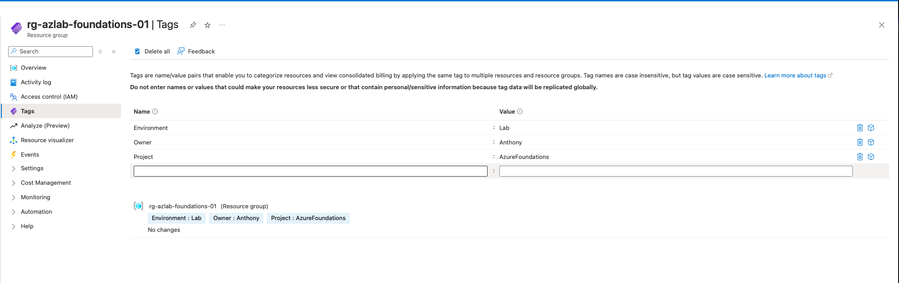

# Project 01 — Resource Groups and Tags

**Status: Completed — November 14, 2026**

## Goal

Learn how to create an Azure resource group, add tags, check the configuration, and delete the group when finished.

A resource group is like a folder for related Azure resources. Tags are labels that help identify their purpose and owner.

## Tools

- Azure Portal
- Azure Cloud Shell — Bash
- Azure CLI

## Lab steps

Open Cloud Shell in the Azure Portal and select **Bash**. Choose **No storage account required** if prompted.

### 1. Check the subscription

```bash
az account show --output table
```

If needed, select your lab subscription:

```bash
az account set --subscription "<YOUR-LAB-SUBSCRIPTION-ID>"
```

### 2. Check the name and create the group

```bash
az group exists --name rg-azlab-foundations-01
```

Continue only if the result is `false`. If the name already exists, choose a different dedicated lab name and use it in every command below.

```bash
az group create \
  --name rg-azlab-foundations-01 \
  --location eastus \
  --tags Owner=Anthony Environment=Lab Project=AzureFoundations
```

### 3. Check the group and tags

```bash
az group show \
  --name rg-azlab-foundations-01 \
  --query "{Name:name,Location:location,State:properties.provisioningState,Tags:tags}" \
  --output json
```

Expected: location `eastus`, state `Succeeded`, and the three tags.

### 4. Clean up

Confirm the correct subscription and check that the lab group is empty:

```bash
az account show --output table
az resource list --resource-group rg-azlab-foundations-01 --output table
```

If the group is empty and belongs to this lab, delete it. Review the group name at the confirmation prompt:

```bash
az group delete --name rg-azlab-foundations-01
az group exists --name rg-azlab-foundations-01
```

Expected final result: `false`.

## My learning notes

- **What I learned:** I found using Azure CLI in Bash easier than navigating the GUI for this lab. I can see how repeatable commands would help with routine tasks in an enterprise environment.
- **Issues:** I ran into no issues.
- **Cleanup:** Successful, based on my lab completion notes. A cleanup screenshot is not included.
- **Cost takeaway:** Tags organize resources; removing tags does not stop charges. Billable resources must be deleted when they are no longer needed.

## Screenshots

The portal shows the resource group's original tags:



Azure CLI shows the group in East US with a successful provisioning state and the added `CostCenter=Training` tag:



## Cost note

This lab creates an empty resource group with no paid workloads. Existing resources or Cloud Shell storage can still incur charges. Only delete the dedicated lab group.

## Reference

[Microsoft Learn — Azure resource group commands](https://learn.microsoft.com/en-us/cli/azure/group?view=azure-cli-latest)
