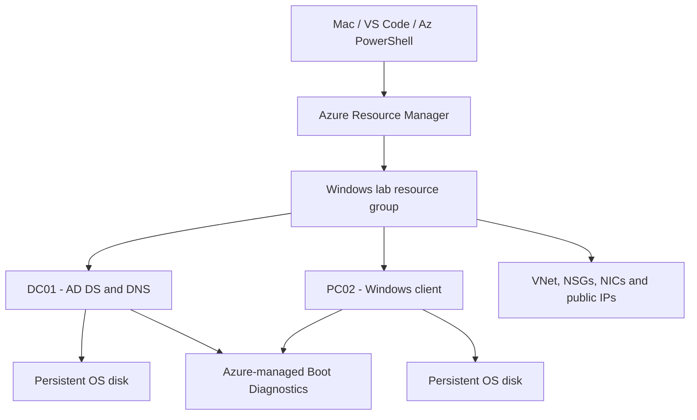

# CloudOps Guardian

**Status:** In progress — Week 1, Day 1 completed (November 24, 2026)

## Business problem

A small organization has migrated Windows infrastructure to Azure but needs better visibility into resource ownership, spending, configuration and operational health. This four-week learning project builds a repeatable cloud operations toolkit using my existing hybrid Active Directory lab.

## Technologies

Azure Virtual Machines, managed disks, virtual networks, NSGs, public IPs, Azure Storage, Boot Diagnostics, Az PowerShell, VS Code on macOS, Git and GitHub.

## Architecture



Tailscale provides remote access when the VMs have working internet connectivity. Cloud Shell storage is separate from the Windows lab resource group.

## Week 1 — Day 1: Infrastructure and cost audit

- Configured the local project workspace and practiced Git staging, commits and pushing.
- Built and tested a PowerShell resource inventory script: 20 resources initially, including two VMs, two disks, two public IPs and three storage accounts. Seventeen resources had no tags; governance review is pending.
- Audited attached Standard SSD LRS disks (127 and 128 GiB) and two attached static Standard public IPs in East US.
- Investigated storage dependencies and found DC01 referencing a custom diagnostic account absent from the visible inventory, while PC02 referenced an existing custom account.
- Migrated both VMs to Azure-managed Boot Diagnostics. Verified both had diagnostics enabled with blank custom storage URIs.
- Inspected blob containers, file shares, queues and tables. One old account returned no containers; the other contained historical PC02 diagnostic data. Neither returned file shares, queues or tables.
- Removed two old storage accounts after investigation; the final audit confirmed no customer-managed storage accounts remained in the lab resource group. Retained the persistent OS disks and separate Cloud Shell storage.
- Reviewed VM sizing; final audit showed both VMs using Standard_D2als_v7. Performance and savings have not been measured.
- Built and successfully ran a read-only cost and configuration audit script.

## Troubleshooting lesson

The initial PowerShell attempt to enable managed Boot Diagnostics retained the old storage URI. Explicitly setting the URI to null, applying the VM configuration with Update-AzVM, and retrieving a fresh configuration resolved the discrepancy. This reinforced the importance of verifying the actual state after a successful command.

Boot Diagnostics stores console screenshots and serial logs; it is separate from the persistent OS disk that holds Windows, Active Directory and GPOs. Managed diagnostics reduces customer-managed storage dependencies without removing the diagnostic feature.

## Results

| Check | Result |
|---|---|
| Compute | Both VMs running at final audit; Standard_D2als_v7 |
| Managed disks | No unattached disks found |
| Public IPs | No unassociated candidates found |
| Lab storage accounts | None remaining |
| Boot Diagnostics | Azure-managed on both VMs |
| Cost audit execution | Successful, no warnings |

Customer-managed storage account count in the lab decreased from two to zero. Actual billing savings are not yet verified. The audit does not prove VM performance, diagnostic capture, complete security compliance or absence of all costs.

## Scripts

- [Get-CloudInventory.ps1](Scripts/Get-CloudInventory.ps1): discovers resources, VM states and missing tags.
- [Get-CloudCostAudit.ps1](Scripts/Get-CloudCostAudit.ps1): checks compute states, unattached disks, public IP candidates, lab storage accounts and diagnostic configuration.
- Azure-WindowsLab management script: start, stop and status operations; a v4 update was prepared to add diagnostic and storage status checks, but runtime validation remains pending.

## Running the audits

Use PowerShell 7 with Az.Accounts, Az.Resources, Az.Compute, Az.Network and Az.Storage installed. Authenticate using Connect-AzAccount and verify Get-AzContext before running from the project directory.

```powershell
./Scripts/Get-CloudInventory.ps1
./Scripts/Get-CloudCostAudit.ps1
```

The audit scripts are read-only. Deallocate lab VMs when not needed; disks, public IPs and storage usage may still incur costs. The preferred monthly budget is $100, not a hard spending cap. Verify the budget alerts and actual charges in Cost Management.

## Roadmap

- Week 1: Infrastructure, cost, governance and network security (Day 1 complete; tagging and Azure Policy next).
- Week 2: Monitoring and observability.
- Week 3: Automation and infrastructure as code.
- Week 4: Reliability, recovery and final portfolio documentation.

## Lessons learned

Discover resources before changing them, investigate dependencies before deletion, use managed services where appropriate, and verify every remediation. This is a personal learning lab, not production experience.
